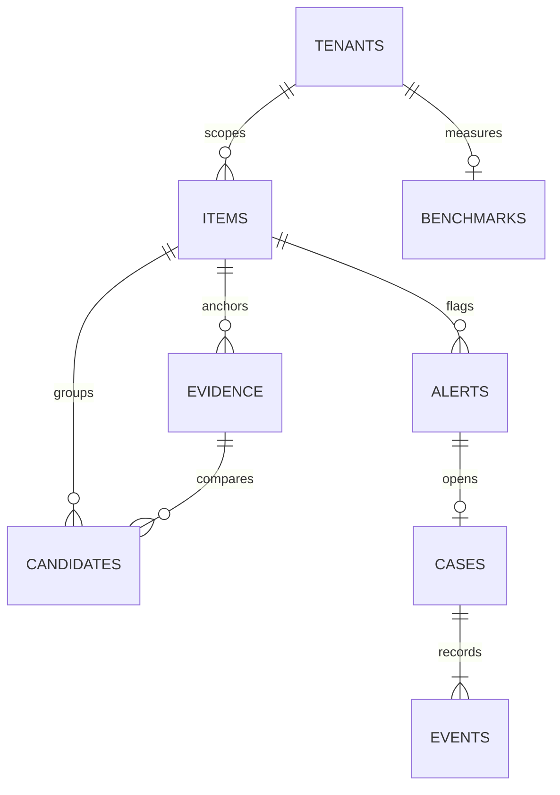

# Data model

Composite primary keys and foreign keys include the tenant. Candidate rows have explicit source-pair references. Cases reference alert rows and have immutable revisioned history. A tenant and case scoped unique idempotency key prevents repeated decisions. Compare-and-update revision checks protect stale requests. PostgreSQL uses row locks and SQLite uses immediate transactions for concurrent decisions.

The evidence registry stores a distinct row per source item with an identity, employment, address, obligation, payment, beneficiary, correspondence, or document kind. Kind-specific attributes sit in structured payloads. Direct payment-to-obligation references and alert evidence IDs are generated and checked by the pipeline. The migration does not separately normalize those payload attributes into typed child tables.

Run `python -m pensiontrace migrate` to apply migration 1. A version row records the applied schema. Repeated migration and seeding are supported. To regenerate data with a different seed, use a new database.
