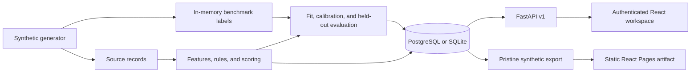

# System architecture

Python builds the source dataset, candidate pairs, discrepancy cases, and benchmark report. The repository uses small explicit SQL migrations through psycopg or SQLite and a FastAPI interface. Decision requests use a case revision, authorized role, and idempotency key. Case updates and audit events commit in the same transaction. An evidence projection joins source record references, candidate pairs, and decisions by tenant and case.

The Vite build bundles a React and TypeScript SPA with a self-contained synthetic data asset. The local developer build can use the authenticated API through a same-origin Vite proxy. The static artifact carries no operational database or credentials.
