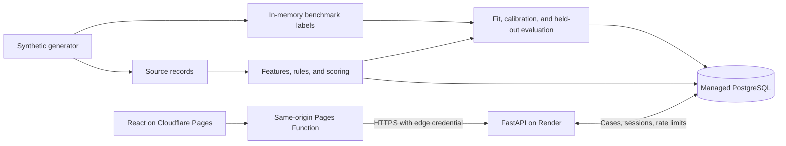

# System architecture

Python builds the source dataset, candidate pairs, discrepancy cases, and benchmark report. Versioned initialization is transactional and idempotent. A separate SQLite profile supports local iteration. Decision requests use a case revision, authorized account, and idempotency key. Case updates and audit events commit together.

The Pages artifact contains UI assets only. The browser restores sessions from the authenticated API, searches the active tenant's PostgreSQL data, and uses server-generated audit exports. The Pages Function injects its Render origin and secret at runtime. Cookies are issued on the frontend origin.
